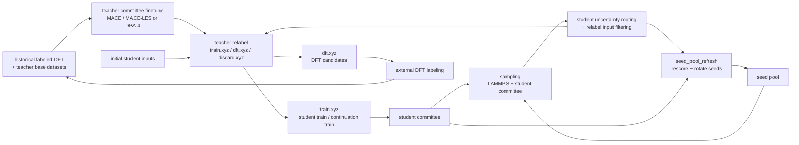

# DICE 核心算法导引

`DICE (Distillation-driven Co-Evolution)` 是一个面向机器学习势函数的闭环主动学习工作流。当前 `v0.1.0` release 默认主线使用 MACE / MACE-LES teacher committee 提供高质量标注与候选分流，使用 DeepMD student committee 执行低成本采样、不确定度评估和持续训练。DeepMD DPA-4 已作为上游 teacher backend 接入，可替代默认 MACE teacher committee。

本文聚焦算法结构和阶段衔接；启动、日志和环境细节见用户手册与环境依赖说明。

当前正式顶层主线是：

- `workflow.py`
  - `committee_cycle`
    - `teacher_committee_finetune`
    - `student_pipeline` stages

当前 student pipeline 不是旧版固定 `dp_r0 / dp_r1 / dp_r2...` 循环，而是由 `student_pipeline_schedule` 展开为一串具体 stage：

- `entry` template 执行 1 次
- `long_cycle` template 执行 1 次
- `short_cycle` template 执行 3 次

---

## 1. 总体算法流程



这条主线的核心思想可以概括为：

- 用 `teacher committee` 负责高质量标注、均值标签生成和 DFT candidate 分流；
- 用 `student committee` 负责低成本 MD 采样和不确定度路由；
- 用 `teacher relabel -> student train -> sampling -> filtering -> teacher relabel` 构成 student active-learning 内循环；
- 用 `seed pool` 保存、重评分和轮换难点结构；
- 用外部 DFT 回灌把 teacher 仍不确定的结构转化为下一轮 teacher finetune 的高质量数据，形成 outer round 回路；
- 用 `entry / long_cycle / short_cycle` 把内循环拆成显式 stage，而不是隐藏在固定 round loop 里。

---

## 2. Teacher Committee

### 2.1 角色

`teacher committee` 是一组高精度 teacher 模型。默认示例使用 MACE / MACE-LES；同一套 teacher backend 接口也支持 DeepMD DPA-4 teacher。它的职责不是大规模采样，而是：

- 对输入结构做 committee 标注；
- 计算 teacher 间的力预测分歧；
- 用 committee 均值生成 energy / forces / stress 标签；
- 把结构分流到 `train.xyz`、`dft.xyz` 和 `discard.xyz`。

当前训练入口在：

- [`workflow_core/teacher/committee_finetune.py`](./workflow_core/teacher/committee_finetune.py)
- [`workflow_backends/teacher/mace/finetune.py`](./workflow_backends/teacher/mace/finetune.py)
- [`workflow_backends/teacher/deepmd/finetune.py`](./workflow_backends/teacher/deepmd/finetune.py)

当前标注入口在：

- [`workflow_core/labeling/task.py`](./workflow_core/labeling/task.py)
- [`workflow_core/labeling/service.py`](./workflow_core/labeling/service.py)
- [`workflow_core/labeling/routing.py`](./workflow_core/labeling/routing.py)

teacher backend 由 `committee_cycle` 配置中的 `teacher_committee_finetune.teacher_backend` 决定。默认配置为 `mace`；DPA-4 teacher 使用 `deepmd`，配置入口是：

- [`configs/pipelines/committee_cycle/teacher_committee_finetune/deepmd/dpa4/committee_finetune.json`](./configs/pipelines/committee_cycle/teacher_committee_finetune/deepmd/dpa4/committee_finetune.json)

### 2.2 训练数据来源

每个 `outer_round` 的 teacher finetune 数据由两部分合并而成：

- 配置中声明的 `workflow.training_data.base_datasets`
  - 默认从 `user_assets/teacher_finetune/` 解析
  - 当前 release 示例是 `base.xyz`
- 历史 labeled DFT 数据
  - `user_assets/dft/r0/labeled.xyz`
  - `user_assets/dft/r1/labeled.xyz`
  - 依此类推，只读取当前 `outer_round` 之前的轮次

合并后的训练输入写到当前 round 的 teacher finetune artifact 中：

- `runs/<run_name>/artifacts/teacher_round_XXX/committee_cycle/teacher_committee_finetune/input/merged.xyz`

默认 MACE / MACE-LES teacher 的作用是在已有 foundation model 基础上，用项目当前累计的高质量数据得到一个面向本体系的 teacher ensemble。DPA-4 teacher 路径也复用相同的数据合并策略；当前示例配置为 scratch 初始化，也可以通过 DeepMD teacher 配置扩展为匹配本地模型来源的训练方式。

### 2.3 输出形式

teacher committee 输出目录是：

- `runs/<run_name>/artifacts/teacher_round_XXX/committee_cycle/teacher_committee_finetune/`

常见成员目录是：

- `teacher_01/`
- `teacher_02/`
- `teacher_03/`

committee 规模由 `workflow.teacher_num` 决定。当前示例配置为 3 个 teacher，随机种子来自 `workflow.teacher_seeds`。

DPA-4 teacher committee 采用相同的成员目录和 committee 规模语义。训练产物由 DeepMD backend 发布，根目录下会写入 DeepMD teacher metadata，后续 relabel 用它识别 `model_family = "dpa4"` 和 `type_map`。

### 2.4 标注与分流算法

在 teacher relabel 阶段，同一个结构会被所有 teacher 模型分别计算：

- energy
- forces
- stress

然后：

- energy / forces / stress 使用 committee 均值作为最终标签；
- teacher 间的 forces 分散程度用于计算 `force_uncertainty`。

当前 teacher uncertainty 的核心定义是：

1. 对每个原子，计算不同 teacher 力预测相对均值的均方偏差；
2. 得到每个原子的 force std；
3. 取全结构最大原子 std 作为该结构的 `force_uncertainty`。

分流逻辑在 [`workflow_core/labeling/routing.py`](./workflow_core/labeling/routing.py)：

- 非法结构或超过 `max_force` 的结构进入 `discard.xyz`；
- `force_uncertainty < teacher_trust_lo` 的结构进入 `train.xyz`；
- 其余结构进入 `dft.xyz`；
- 如果配置了 `teacher_trust_hi`，高于该上界的结构也可以进入 discard 路径。

这意味着 teacher committee 的核心任务是：

- 把 teacher 已经足够稳定的结构交给 student 训练；
- 把 teacher 仍不确定的结构留作 DFT candidate；
- 把明显不合理或超出约束的结构丢弃。

当上游 teacher backend 为 DeepMD DPA-4 时，student pipeline 中的 relabel stage 会继承 `teacher_committee_finetune.teacher_backend = "deepmd"`。DPA-4 relabel 默认使用 LAMMPS engine 执行 DeepMD 模型推理；如果 stage 配置显式写 `teacher_backend`，必须与上游 teacher backend 一致。

---

## 3. Student Committee

### 3.1 角色

`student committee` 是一组 DeepMD student 模型。它的职责是：

- 在 MD 采样中快速计算结构；
- 基于 committee model deviation 给采样帧打不确定度；
- 将采样帧路由为 accurate / candidate / failed；
- 为下一轮 teacher relabel、student train 和 seed pool refresh 提供输入。

当前 DeepMD backend 入口在：

- [`workflow_backends/student/deepmd/backend.py`](./workflow_backends/student/deepmd/backend.py)
- [`workflow_backends/student/deepmd/training.py`](./workflow_backends/student/deepmd/training.py)
- [`workflow_backends/student/deepmd/sampling.py`](./workflow_backends/student/deepmd/sampling.py)

当前 pipeline stage 入口在：

- [`workflow_core/student_pipeline/stages/train_stage.py`](./workflow_core/student_pipeline/stages/train_stage.py)
- [`workflow_core/student_pipeline/stages/sampling_stage.py`](./workflow_core/student_pipeline/stages/sampling_stage.py)

### 3.2 训练方式

student committee 是多成员独立训练：

- committee size 来自 `student_model.committee_size`；
- 每个成员使用 `deepmd.training.model_seeds` 中的不同 seed；
- 每个成员有独立训练目录；
- 训练结束后发布到 stage 的 `student_committee/` 目录；
- stage 同时写出 `student_committee_summary.json`。

只有成功完成并被 summary 记录的 student 成员会被后续 sampling stage 使用。

### 3.3 不确定度定义

当前 student committee 的核心不确定度指标是：

- `force_std_max`

定义是：

1. 对同一帧，所有 student 成员分别计算力；
2. 对每个原子，计算该原子在不同模型间的力分散；
3. 取所有原子中的最大值，作为该帧的 `force_std_max`。

相关实现位置：

- [`workflow_backends/student/deepmd/uncertainty.py`](./workflow_backends/student/deepmd/uncertainty.py)
- [`workflow_backends/lammps/model_devi_parser.py`](./workflow_backends/lammps/model_devi_parser.py)

该指标直接决定采样帧的路由，也参与 seed selection 和 seed pool refresh。

---

## 4. Student Pipeline Schedule

### 4.1 从旧 round loop 到显式 stage schedule

当前 release 的 student active learning 由 `subworkflow.json` 中的 `student_pipeline_schedule` 决定：

```json
[
  {"template": "entry", "repeat": 1},
  {"template": "long_cycle", "repeat": 1},
  {"template": "short_cycle", "repeat": 3}
]
```

模板展开逻辑在：

- [`workflow_core/student_pipeline/orchestration/state_store.py`](./workflow_core/student_pipeline/orchestration/state_store.py)
- [`workflow_core/student_pipeline/orchestration/template_loader.py`](./workflow_core/student_pipeline/orchestration/template_loader.py)
- [`workflow_core/student/planning.py`](./workflow_core/student/planning.py)

展开后，每个 template invocation 对应一个 `student_round_YYY`。每个 student round 由 template 中列出的 stage 顺序执行。

### 4.2 entry template

`entry` template 包含：

- `relabel`
- `train`

算法含义是：

1. 从 `initial_student_inputs` 取得初始结构；
2. 使用当前 teacher committee 进行 relabel；
3. 将 teacher 分流后的 `train.xyz` 作为 entry train 数据；
4. 训练第一个 DeepMD student committee。

当前配置中：

- 初始输入来自 `user_assets/student_initial/bootstrap.xyz`；
- entry train 使用 `stages/train/entry_train.json`；
- `train_regime.use_foundation_model = false`，所以 entry train 从 scratch 开始。

### 4.3 long_cycle template

`long_cycle` template 包含：

- `sampling`
- `student_relabel_input_filtering`
- `relabel`
- `train`
- `seed_pool_refresh`

算法含义是：

1. 从当前 seed pool 中按高不确定度选少量 seed；
2. 使用 DeepMD student committee + LAMMPS 跑较长 MD；
3. 将采样帧按 student 不确定度分为 candidate / failed 等输出；
4. 对 candidate / failed 做每个 system 的数量控制；
5. 交给 teacher committee relabel；
6. 用 relabel 后的 `train.xyz` 继续训练 student committee；
7. 用新 student committee 重评分并刷新 seed pool。

当前 long sampling 的核心配置是：

- `selection_mode = top_uncertainty_per_system`
- `n_seed_per_system = 1`
- `temperature_schedule = [273, 323, 373]`
- `steps = 20000`

long cycle 的目标是扩大探索范围，优先观察当前最不稳定的 seed。

### 4.4 short_cycle template

`short_cycle` template 与 `long_cycle` 的 stage 类型相同，但 sampling 和 refresh 策略不同。

当前 short sampling 的核心配置是：

- `selection_mode = usage_then_uncertainty_per_system`
- `n_seed_per_system = 15`
- `temperature_schedule = [273, 373]`
- `steps = 1000`

short cycle 的目标是：

- 用更多 seed 覆盖已有 seed pool 内的难点；
- 用较短轨迹降低单次采样成本；
- 通过 `times_used` 轮换修补不同难点区域；
- 持续用最新 teacher / student committee 改善局部问题。

---

## 5. Sampling 与帧路由

### 5.1 LAMMPS sampling stage

当前 DeepMD 主线使用 LAMMPS sampling backend。sampling stage 的核心输入是：

- 最新成功 train stage 的 `student_committee_summary.json`；
- 当前有效 seed pool；
- 当前 stage 的 MD 配置；
- 全局 student uncertainty 阈值。

sampling stage 的核心输出是：

- `seed_pool.xyz`
  - 本次实际选中的 seed
- `candidate.xyz`
  - student committee 认为值得进入 teacher relabel 的候选
- `failed.xyz`
  - student committee 高不确定或采样失败相关结构
- `seed_pool_after_sampling.xyz`
  - 采样后带有使用状态更新的 seed pool successor

### 5.2 帧路由规则

当前主线用 `uncertainty.trust_lo` 和 `uncertainty.trust_hi` 控制 student 采样帧路由。示例配置为：

- `trust_lo = 0.10`
- `trust_hi = 0.40`

路由语义是：

- `accurate`
  - `force_std_max < trust_lo`
- `candidate`
  - `trust_lo <= force_std_max < trust_hi`
- `failed_uncertainty`
  - `force_std_max >= trust_hi`

`accurate` 帧主要进入统计；`candidate` 和 `failed` 会被后续 filtering、teacher relabel 或 seed pool refresh 使用。

### 5.3 relabel input filtering

采样结束后，工作流不会把所有 candidate / failed 都送入 teacher relabel，而是先执行 `student_relabel_input_filtering`。

当前 shipped 配置使用：

- `selection_mode = random_per_system`
- long cycle candidate cap: 每个 system 最多 1000
- short cycle candidate cap: 每个 system 最多 700
- failed cap: 每个 system 最多 3000

这样做的目的不是改变不确定度定义，而是控制 teacher relabel 的输入规模，并避免单个 system 的采样帧挤占全部预算。

实现位置：

- [`workflow_core/student_pipeline/stages/student_relabel_input_filtering_stage.py`](./workflow_core/student_pipeline/stages/student_relabel_input_filtering_stage.py)
- [`workflow_core/student_pipeline/services/filtering/student_relabel_input_filtering.py`](./workflow_core/student_pipeline/services/filtering/student_relabel_input_filtering.py)

---

## 6. Seed Pool 策略

### 6.1 作用

seed pool 是 student pipeline 内部维护的“下一次 sampling 初始结构池”。它的作用是：

- 保存当前 workflow 认为仍有价值的结构；
- 为 long / short sampling 提供稳定 seed 来源；
- 保存 `force_std_max`、`system_id`、`structure_id`、`times_used` 等 metadata；
- 让短轮可以在不同难点 seed 之间轮换。

当前 seed pool 不是旧版 `seed_pool_policy.enabled` 控制的全局任务，而是由 stage artifact resolver 和 `seed_pool_refresh` stage 共同维护。

相关实现：

- [`workflow_core/student_pipeline/artifacts/successful_stage_resolver.py`](./workflow_core/student_pipeline/artifacts/successful_stage_resolver.py)
- [`workflow_core/student_pipeline/stages/seed_pool_refresh_stage.py`](./workflow_core/student_pipeline/stages/seed_pool_refresh_stage.py)
- [`workflow_policies/seed_selection.py`](./workflow_policies/seed_selection.py)
- [`workflow_policies/seed_pool_refresh.py`](./workflow_policies/seed_pool_refresh.py)

### 6.2 初始化

初始 seed pool 来自 `subworkflow.json` 的：

```json
"source": {
  "initial_seed_pool": [
    "initial_physical_seed.xyz"
  ]
}
```

默认解析到：

- `user_assets/seed_pool/initial_physical_seed.xyz`

当 schedule 中存在 sampling 或 seed pool refresh stage 时，工作流会把初始 seed pool 快照到：

- `runs/<run_name>/artifacts/teacher_round_XXX/committee_cycle/student_subworkflow/source/initial_seed_pool.xyz`

### 6.3 选种策略

当前 long sampling 使用：

- `top_uncertainty_per_system`

即每个 system 内优先选择 `force_std_max` 高的 seed。

当前 short sampling 使用：

- `usage_then_uncertainty_per_system`

排序规则是：

1. `times_used` 升序；
2. `force_std_max` 降序。

这表示：

- long cycle 偏向“最大化探索”；
- short cycle 偏向“轮换修补已有难点”。

### 6.4 refresh 策略

`seed_pool_refresh` stage 会使用最新 student committee 对输入 seed pool、candidate increment 和 failed increment 重新打分，再按策略筛选。

当前 long refresh 配置：

- `selection_mode = top_uncertainty_per_system`
- `max_pool_size_per_system = 500`
- `keep_if_lt_high = 0.40`
- `dedup_enabled = true`

当前 short refresh 配置：

- `selection_mode = usage_then_uncertainty_per_system`
- `max_pool_size_per_system = 500`
- `keep_if_lt_high = 0.40`
- `dedup_enabled = true`

因此 refresh 的核心行为是：

- 用新 student committee 更新 seed 的 `force_std_max`；
- 过滤掉超过 high trust 的结构；
- 按每个 system 的预算保留 seed；
- 让后续 sampling 使用刷新后的 seed pool。

---

## 7. Student 持续训练策略

### 7.1 train_regime

当前配置：

```json
"train_regime": {
  "use_foundation_model": false,
  "continue_training": true
}
```

其算法含义是：

- entry train 不使用 student foundation model，从 scratch 训练；
- 后续 train stage 从前一个成功 student committee 继续训练；
- 因为 `continue_training = true`，训练数据模式是 incremental。

解析逻辑在：

- [`workflow_core/student_pipeline/config/train_regime.py`](./workflow_core/student_pipeline/config/train_regime.py)
- [`workflow_core/student_pipeline/artifacts/stage_artifacts.py`](./workflow_core/student_pipeline/artifacts/stage_artifacts.py)

### 7.2 entry train

entry train 的输入来自前一个 relabel stage 的：

- `label/train.xyz`

训练 recipe 是：

- `stages/train/entry_train.json`

当前 entry train 的角色是建立本 outer round 的第一个 DeepMD student committee。

### 7.3 continuation train

long / short cycle 中的 train stage 使用：

- `stages/train/continuation_train.json`

当 `continue_training = true` 时，它会解析最近成功 train stage 的 student committee 作为 previous committee，并用当前 relabel stage 的增量 `train.xyz` 继续训练。

这意味着当前 student 演化链的核心特征是：

- 模型参数跨 stage 延续；
- 数据按 stage 增量进入；
- 不是每个 student round 都把全历史训练集重新拼接后从零训练。

---

## 8. 外部 DFT 回灌在算法中的位置

当前 release 的 shipped DeepMD schedule 没有启用独立的 `teacher_dft_candidate_filtering` stage，因此 DFT screening 不是默认主线中的必经算法阶段。

默认主线中，teacher relabel 会输出：

- `label/train.xyz`
  - teacher 足够确定，可用于 student train
- `active_learning/dft.xyz`
  - teacher 不够确定，应作为 DFT candidate
- `label/discard.xyz`
  - 不合法或超出约束的结构

用户可以从各 relabel stage 的 `active_learning/dft.xyz` 中整理外部 DFT 输入。外部 DFT 完成后，将结果回灌到：

- `user_assets/dft/r<outer_round>/labeled.xyz`

下一轮 `outer_round` 启动时，teacher finetune 会自动把这些 labeled DFT 数据纳入训练集。

代码库中仍包含 first-principles handoff 和 screening 相关基础设施，例如：

- [`workflow_policies/first_principles_screening/`](./workflow_policies/first_principles_screening/)
- [`workflow_core/student_pipeline/stages/teacher_dft_candidate_filtering_stage.py`](./workflow_core/student_pipeline/stages/teacher_dft_candidate_filtering_stage.py)
- [`workflow_core/first_principles/`](./workflow_core/first_principles/)

这些能力需要在 schedule 和环境中显式启用；默认 shipped mainline 采用外部 DFT 回灌，不把它们作为必经闭环步骤。

---

## 9. 当前主线的算法特征总结

把当前 release 主线压缩成一句话，可以概括为：

- teacher committee 负责可靠标注和 DFT candidate 分流；
- student committee 负责低成本采样、不确定度路由和持续训练；
- entry stage 建立第一个 student committee；
- long cycle 负责少 seed、长轨迹的探索；
- short cycle 负责多 seed、短轨迹的局部修补；
- seed pool 负责保存和轮换难点结构；
- 外部 DFT 回灌负责把 teacher 不确定的候选转化为下一轮 teacher finetune 数据。

因此，当前工作流不是单纯的“采样 -> 训练 -> 再采样”，而是两条耦合演化链：

- teacher chain
  - foundation model + base datasets + historical labeled DFT -> teacher committee -> relabel / DFT candidate
- student chain
  - relabel train data + seed pool + sampling uncertainty -> student committee -> new candidate / refreshed seed pool

两条链通过 `train.xyz`、`dft.xyz`、`seed_pool.xyz` 和外部 DFT 回灌共同推动体系逐步收敛。
