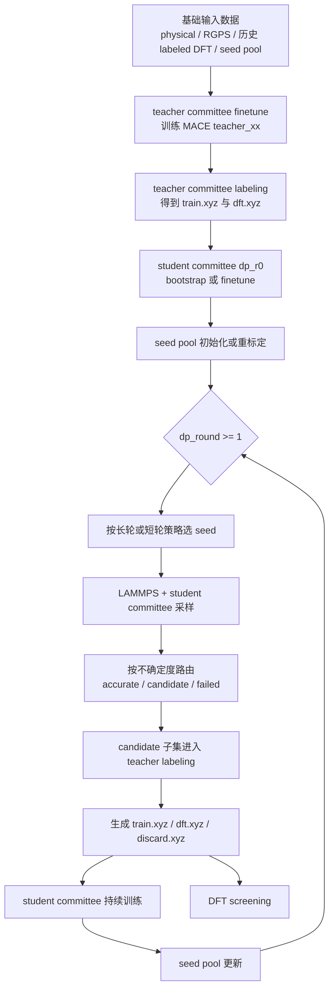

# 项目核心算法文档

这份文档说明当前正式工作流的核心算法设计。它不讨论服务器操作、日志查看、同步命令等使用细节，只说明当前主线在做什么，以及各个阶段之间如何衔接。

当前正式顶层主线是：

- `committee_cycle`
  - `MACE teacher committee finetune`
  - `DP active-learning subworkflow`

---

## 1. 总体算法流程

这条主线的核心思想可以概括为：

- 用 `teacher committee` 负责高质量标注与筛分；
- 用 `student committee` 负责低成本大规模采样与不确定度评估；
- 用 `长轮 + 短轮` 的采样调度在“探索新区域”和“反复打磨难点”之间切换；
- 用 `seed pool` 把难点结构持续保存在工作流内部；
- 用 `DFT screening` 控制最终需要进入高成本 DFT 阶段的结构规模与多样性。

---

## 2. Teacher Committee

## 2.1 角色

`teacher committee` 是一组 MACE teacher 模型。它的职责不是大规模采样，而是：

- 对输入结构做 committee 标注；
- 计算 teacher 间的分歧；
- 把结构分流到：
  - `train.xyz`
  - `dft.xyz`
  - `discard.xyz`

当前正式实现中，teacher committee 的训练入口在：

- [workflow_core/mace/committee_finetune.py](C:\Users\1\Desktop\mlff_workflow\workflow_core\mace\committee_finetune.py)

teacher committee 的使用入口在：

- [workflow_core/labeling/task.py](C:\Users\1\Desktop\mlff_workflow\workflow_core\labeling\task.py)
- [workflow_core/labeling/label.py](C:\Users\1\Desktop\mlff_workflow\workflow_core\labeling\label.py)

## 2.2 Teacher Committee 的训练数据来源

每个 `outer_round` 的 teacher finetune 数据由以下几部分合并而成：

- `physical` 数据
- 可选 `RGPS` 基础数据
- 历史各轮已经完成的 `labeled DFT` 数据

合并后的数据写成一个统一的 `train_merged.xyz`，再据此训练多份 teacher 模型。

因此，teacher committee 的作用不是从零训练一个全新势，而是在：

- 既有 foundation model 的基础上，
- 用当前项目累计下来的高质量数据，
- 得到一个面向本项目体系的 teacher ensemble。

## 2.3 Teacher Committee 的输出形式

teacher committee 输出目录的逻辑形式是：

- `runs/<run_name>/results/mace_committee_model/r<outer_round>/teacher_xx/`

每个 `teacher_xx` 是一个独立 teacher 成员。整个 committee 的规模由 `teacher_num` 决定。

## 2.4 Teacher Committee 的标注算法

在 teacher labeling 阶段，同一个结构会被所有 teacher 模型分别计算：

- energy
- forces
- stress

然后：

- 用各 teacher 的平均值作为最终标签；
- 用各 teacher 力预测的分散程度作为 `force_uncertainty`。

当前实现中，teacher uncertainty 的核心定义是：

- 对每个原子先计算不同 teacher 力预测的标准差；
- 再取全结构最大原子不确定度作为该结构的不确定度。

随后用 `candidate_sigma_threshold` 把结构分成两类：

- `uncertainty < threshold`
  - 进入 `train.xyz`
- `uncertainty >= threshold`
  - 进入 `dft.xyz`

当前 teacher labeling 中：

- `discard.xyz` 这条通路默认关闭，主要仍由 `train.xyz` 和 `dft.xyz` 两类承担分流。

这意味着 teacher committee 的核心任务是：

- 把“已经足够稳定、可直接进入 DP 训练”的结构留在 `train.xyz`
- 把“teacher 仍然不够确定”的结构送入后续 DFT 候选池

---

## 3. Student Committee

## 3.1 角色

`student committee` 是一组 DeepMD student 模型。它的职责是：

- 在大量结构上进行快速推理；
- 作为采样阶段的低成本 committee；
- 为每个采样帧计算不确定度；
- 决定哪些结构已经足够准确，哪些需要继续训练，哪些应升级为高不确定度候选。

当前正式实现的训练入口在：

- [workflow_core/dp/train_committee.py](C:\Users\1\Desktop\mlff_workflow\workflow_core\dp\train_committee.py)

采样入口在：

- [workflow_core/dp/sample_committee.py](C:\Users\1\Desktop\mlff_workflow\workflow_core\dp\sample_committee.py)

## 3.2 Student Committee 的训练方式

student committee 不是单模型训练，而是多成员独立训练：

- 每个成员有自己的 `model_seed`
- 每个成员有自己的训练目录
- 每个成员最终产出一个 `graph.pb`

训练完成后，工作流会汇总出一个 `summary.json`，其中记录：

- committee 大小
- 成功成员
- 各成员输出路径
- 各成员训练结果

只有成功完成的 student 成员会被用于后续采样。

## 3.3 Student Committee 的不确定度定义

当前正式主线中，student committee 的核心不确定度指标是：

- `force_std_max`

其定义是：

1. 对同一帧，所有 student 成员分别计算力；
2. 对每个原子，计算该原子在不同模型间的力分散；
3. 取所有原子中的最大值，作为该帧的 `force_std_max`。

当前实现位置在：

- [workflow_backends/deepmd/uncertainty.py](C:\Users\1\Desktop\mlff_workflow\workflow_backends\deepmd\uncertainty.py)

这个指标直接决定采样帧的分类与 seed pool 的重标定结果。

---

## 4. 长短轮采样策略

## 4.1 总体调度

当前正式配置的采样调度模式是：

- `long_first_then_short`

也就是：

- `dp_r1` 使用长轮 `long_exploration`
- `dp_r2` 及之后使用短轮 `short_refinement`

当前解析逻辑在：

- [workflow_core/dp/sampling_config.py](C:\Users\1\Desktop\mlff_workflow\workflow_core\dp\sampling_config.py)
- [workflow_core/dp/round_finalize.py](C:\Users\1\Desktop\mlff_workflow\workflow_core\dp\round_finalize.py)

## 4.2 长轮的目标

长轮的目标是：

- 用较少 seed
- 跑较长轨迹
- 用更多温度
- 尽可能扩大探索范围

当前正式长轮配置的核心特征是：

- 每个 system 取 `1` 个 seed
- 选种模式：
  - `top_uncertainty_per_system`
- 温度：
  - `273 / 323 / 373`
- MD 步数：
  - `20000`

长轮强调的是：

- 覆盖更大的结构空间；
- 优先观察当前最不稳定、最需要探索的 seed；
- 把新的 candidate 和 failed 结构补充进 seed pool。

## 4.3 短轮的目标

短轮的目标是：

- 用较多 seed
- 跑较短轨迹
- 在已经发现的问题区域内做密集修补

当前正式短轮配置的核心特征是：

- 每个 system 取 `15` 个 seed
- 选种模式：
  - `usage_then_uncertainty_per_system`
- 温度：
  - `273 / 373`
- MD 步数：
  - `1000`

短轮强调的是：

- 尽量覆盖更多当前 pool 内的难点 seed；
- 控制单条轨迹长度；
- 提高对局部难点区域的修正效率。

## 4.4 Student Committee 采样时如何路由帧

当前正式采样主线中，每一帧按 student committee 的不确定度划分为：

- `accurate`
  - `force_std_max < f_trust_lo`
- `candidate`
  - `f_trust_lo <= force_std_max < f_trust_hi`
- `failed_uncertainty`
  - `force_std_max >= f_trust_hi`

当前正式阈值通常是：

- `f_trust_lo = 0.10`
- `f_trust_hi = 0.40`

因此，采样阶段的核心逻辑是：

- `accurate` 帧只计入统计，不再进入后续高成本环节；
- `candidate` 帧进入候选集；
- `failed_uncertainty` 帧表示明显高不确定区域，也会被单独保留。

## 4.5 Candidate 如何进入下一轮训练

采样结束后，工作流不会把所有 `candidate` 全部送入下一轮训练，而是先做一轮训练子集筛选。

当前正式配置中：

- 长轮：
  - `random_per_system`
  - 每个 system 最多 `1000`
- 短轮：
  - `random_per_system`
  - 每个 system 最多 `700`

也就是说：

- 采样阶段先尽量广泛保留 candidate；
- 真正进入 teacher labeling 与后续 DP 增量训练的数据，会再做一次按 system 的子集抽取。

这样做的作用是：

- 避免单个 system 的 candidate 过多挤占训练配额；
- 保持各 system 在训练集中的基本均衡。

---

## 5. Seed Pool 初始化与更新策略

## 5.1 Seed Pool 的作用

seed pool 是工作流内部维护的“下一轮采样初始结构池”。它的作用是：

- 把已经发现的高价值结构持续保留下来；
- 为后续长轮和短轮提供稳定的 seed 来源；
- 记录每个 seed 被使用过多少次，以支持短轮的轮换修补策略。

当前实现入口在：

- [workflow_core/seed_pool/service.py](C:\Users\1\Desktop\mlff_workflow\workflow_core\seed_pool\service.py)

## 5.2 Seed Pool 初始化

在 `seed_pool_policy.enabled = true` 且 `initialize_at_subworkflow_start = true` 时：

- 工作流开始进入 DP 子流程时，
- 如果正式 seed pool 文件还不存在，
- 就会执行一次初始化。

初始化后的每个结构都会带上基础 metadata，例如：

- `system_id`
- `structure_id`
- `force_std_max`
- `times_used = 0`

这一步的目标是建立一个可持续更新的正式种子库。

## 5.3 长轮和短轮的选种方式

当前正式主线采用两种选种逻辑。

### 长轮选种

按每个 system 内的：

- `force_std_max` 降序

也就是优先选当前最不稳定、最值得探索的 seed。

### 短轮选种

按每个 system 内的：

1. `times_used` 升序
2. `force_std_max` 降序

也就是：

- 先优先使用最近较少被采样过的 seed；
- 在使用次数相同的 seed 中，再优先挑最不稳定的 seed。

这套策略的意义是：

- 长轮偏向“最大化探索”
- 短轮偏向“在所有难点之间轮换修补”

## 5.4 短轮采样后的使用次数更新

当前正式主线中，只有短轮会在采样后更新正式 seed pool 的使用次数：

- 实际被选中并用于短轮采样的 seed
- `times_used += 1`

因此：

- `times_used` 是短轮策略中的状态变量；
- 它不是一个历史统计展示字段，而是直接参与下一轮短轮选种排序。

## 5.5 训练后如何刷新 Seed Pool

每次 student committee 训练结束后，如果 `refresh_after_training = true`，工作流会用当前 student committee 对 seed pool 重新打分。

这里的“重新打分”指的是：

- 用最新 student committee 重新计算 seed 的 `force_std_max`
- 再按刷新模式决定如何保留和更新 pool

当前正式主线有两种刷新模式。

### 模式一：`merge_old_pool_with_current_candidate_failed`

这是长轮默认模式。

含义是：

- 把旧 seed pool
- 与当前轮新产生的 `candidate + failed` 结构
- 合并后再重新筛选、重排并回写成新的 seed pool

这是一种“扩池”模式，目标是：

- 把这一轮新发现的难点立即并入正式 seed pool

### 模式二：`rescore_existing_pool_only`

这是短轮默认模式。

含义是：

- 不把当前轮新 candidate / failed 并回正式 seed pool
- 只对当前 pool 中已有 seed 重新计算不确定度并重排

这是一种“重打分”模式，目标是：

- 不快速膨胀 seed pool
- 只用最新 student committee 重新判断已有种子的优先级

## 5.6 Outer Round 切换时的特殊规则

当：

- `outer_round > 0`
- 且 `dp_r0` 完成训练后

当前正式主线会对 seed pool 做一次特殊刷新：

- 使用最新 student committee 重标定
- `times_used = 0`

它的作用是：

- 把上一 outer round 中累积的短轮使用历史清空；
- 让新 outer round 从“重新校准后的当前难点分布”开始选种。

---

## 6. DP 持续训练策略

## 6.1 总体目标

student committee 的训练不是一轮一轮完全重来，而是持续积累、持续微调。

当前正式主线中，DP 训练策略可以概括为：

- `dp_r0` 负责建立当前 outer round 的起点 student committee
- `dp_r1+` 负责在这个起点上持续 finetune

## 6.2 `dp_r0` 的两种来源

### `outer_round = 0`

在最初 outer round 中：

- `dp_r0` 是 bootstrap 阶段
- 训练数据来自：
  - `physical` 数据
  - 可选 `RGPS` 数据

也就是，最早的 student committee 从基础数据直接建立。

### `outer_round > 0`

在后续 outer round 中：

- `dp_r0` 不再从零 bootstrap
- 而是先汇总前一 outer round 所有 `dft.xyz`
- 用当前 teacher committee 重新标注这些候选
- 再以此作为当前 outer round 的 round0 数据源

同时：

- 当前 `dp_r0` 会从上一 outer round 的最终 student committee 继续训练

这意味着每个新 outer round 的 `dp_r0` 是一次：

- “teacher 重新整理上一轮 DFT 候选”
- 加上
- “student 从上一轮最终模型继续 finetune”

## 6.3 `dp_r1+` 的持续训练方式

在同一个 outer round 内：

- `dp_r1` 从 `dp_r0` 继续训练
- `dp_r2` 从 `dp_r1` 继续训练
- 依此类推

当前正式策略中：

- `later_round_stage = finetune`

因此同一 outer round 内的后续 student committee 是连续微调关系，而不是完全独立训练。

## 6.4 当前训练数据纳入方式

当前正式配置中，DP 增量数据策略是：

- `use_incremental_data_only = true`
- `train_on_current_round_increment_only = true`

它意味着：

- 每个 `dp_round` 的训练根目录，当前只指向该轮自己的 `label_dir`
- 工作流不会在每个 `dp_round` 自动把本 outer round 之前所有 `train.xyz` 再次全量拼回同一个训练根

因此，当前正式 student 持续训练的主特点是：

- 模型参数是持续传递的；
- 训练数据按轮次增量进入；
- 不是每轮都做一次全历史全集重训。

## 6.5 架构锁定

当 student committee 进入 `finetune` 阶段后，工作流会锁定结构超参数信息，并写入 `arch_meta.json`。

其作用是：

- 后续 round 的 student committee 必须与前一轮架构兼容；
- 防止在持续训练过程中意外改变模型结构；
- 保证 checkpoint 初始化和后续 freeze 输出的一致性。

因此，当前 student committee 的持续训练不是“松散地复用旧模型”，而是：

- 在固定结构下继续训练参数。

---

## 7. DFT Screening 筛选策略

## 7.1 角色

DFT screening 的目标不是再做一次 committee 标注，而是：

- 在已经进入 `dft.xyz` 的候选结构中
- 控制最终进入高成本 DFT 池的规模
- 同时尽量保留结构多样性和高不确定度代表

当前实现入口在：

- [workflow_core/dft/screening.py](C:\Users\1\Desktop\mlff_workflow\workflow_core\dft\screening.py)

## 7.2 输入来源

在当前 outer round 内，DFT screening 优先使用：

- 当前 outer round 的累计 DFT candidate 池

如果累计池存在，就会优先对累计池做筛选；否则才退回当前轮 `dft.xyz`。

因此，当前 DFT screening 不是只看“这一轮刚新增的候选”，而是更接近：

- “对本 outer round 目前累计的 DFT 候选做统一筛选”

## 7.3 筛选流程

当前正式筛选主线是四段式：

### 第一步：按 system 分组

所有候选先按 system 分开处理，避免不同体系互相挤占预算。

### 第二步：精确去重

对每个 system 内的结构：

- 根据元素、坐标、晶胞、PBC 等信息构造稳定 hash
- 完全重复的结构只保留一个
- 如果同一精确重复组中有多个结构，则优先保留不确定度更高的代表

### 第三步：结构 bucket 去重

对精确去重后的结构，继续构造邻域签名：

- 取若干近邻阶数
- 对每阶近邻距离取分位数
- 再附加最小原子间距

然后：

- 做 robust normalization
- 再按 `bucket_width` 离散成 bucket

这样能够把“局部结构非常接近”的候选归到同一 bucket 中。

### 第四步：每个 bucket 先保留高不确定度代表，再按 system 预算抽样

在同一个 bucket 内：

- 先按不确定度降序排列
- 每个 bucket 先保留前 `keep_top_per_bucket` 层代表
- 再在各 bucket 间按稳定随机种子做打散与填充
- 最终每个 system 只保留不超过 `budget_per_system` 个候选

因此，DFT screening 的核心目标不是单纯“挑最高不确定度的前 N 个”，而是：

- 先保代表性
- 再保高不确定度
- 最后保 system 级预算均衡

## 7.4 筛选后的输出

DFT screening 会输出两层结果：

- 当前 `dp_round` 的 `dft_screened.xyz`
- 当前 outer round 的累计 `screened_dft_pool.xyz`

所以它既有“本轮筛选结果”，也有“当前 outer round 截止目前的正式 screened pool”。

## 7.5 DFT Screening 与停止条件

当前正式配置中，DFT screening 还承担一个停止判据：

- 如果本轮 screened 数量达到阈值；
- 或当前 outer round 的累计 screened 数量达到阈值；

则当前 DP 子流程可以提前停止。

这意味着 DFT screening 不只是后处理，而是会直接影响：

- 当前 outer round 是否继续进行更多 DP round。

---

## 8. 当前正式主线的算法特征总结

把整套主线压缩成一句话，可以概括为：

- `teacher committee` 负责高质量标注与候选分流；
- `student committee` 负责大规模不确定度采样与持续训练；
- `长轮` 负责探索；
- `短轮` 负责修补；
- `seed pool` 负责保存和轮换难点结构；
- `DFT screening` 负责把累计高不确定候选压缩成有限而多样的高价值 DFT 池。

因此，这个工作流不是单纯地“采样 -> 训练 -> 再采样”，而是同时维护了两条耦合演化链：

- 一条是 `teacher committee` 驱动的高质量标签链；
- 一条是 `student committee` 驱动的低成本持续探索链。

这两条链通过：

- `label/train/dft` 分流、
- `seed pool`、
- `DP round` 持续训练、
- `DFT screening`

共同推动整个体系逐步收敛。
