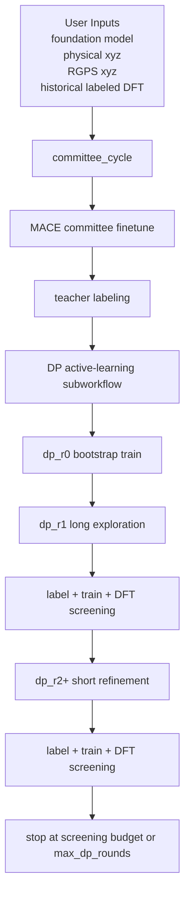

# DICE

`DICE (Distillation-driven Co-Evolution)` 是一个面向机器学习势函数的闭环主动学习工作流。它通过 `MACE / MACE-LES teacher committee` 将知识蒸馏给 `DeepMD student committee`，同时由 `DeepMD student committee` 通过采样探索新的结构分布，并将高价值结构反馈给教师模型继续学习。

当前正式主线已经收束为：

- 顶层只运行 `committee_cycle`
- `committee_cycle` 内部包含：
  - `MACE committee finetune`
  - `DP active-learning subworkflow`
- `DFT` 在当前使用方式中通常作为**工作流外部手动环节**处理，再将结果回灌到下一轮

## Key Features

- `Teacher Committee`
  - 基于 foundation model 和历史标注数据训练 `MACE teacher_xx`
  - 对候选结构进行 committee 标注与分流
- `Student Committee`
  - 训练 `DeepMD` committee
  - 在采样阶段提供 `force_std_max` 不确定度评估
- `Long/Short Sampling Strategy`
  - `dp_r1` 执行长轮探索
  - `dp_r2+` 执行短轮精修
- `Seed Pool`
  - 支持 seed pool 初始化、短长轮差异化选种、使用次数回写和训练后重标定
- `DFT Screening`
  - 对高成本 DFT 候选进行去重、bucket 压缩和按 system 预算筛选
- `External DFT Handoff`
  - 工作流运行结束后可导出 screened DFT pool
  - 用户在工作流外完成 DFT 后，可将结果放回标准路径供下一轮读取

## Workflow Overview



## Current Pipeline

当前顶层 pipeline 为：

- `committee_cycle`

其中：

- `committee_cycle`
  - `MACE committee finetune`
  - `DP active-learning subworkflow`

当前顶层启动 YAML：

- [`Pt-water-interface_roundN.yaml`](./Pt-water-interface_roundN.yaml)

当前服务器启动脚本：

- [`server_start_workflow.sh`](./server_start_workflow.sh)

## Quick Start

### 1. Prepare environment

环境要求说明见：

- [`ENVIRONMENT_REQUIREMENTS.md`](./ENVIRONMENT_REQUIREMENTS.md)

### 2. Prepare user inputs

用户需要准备的输入数据主要位于：

- `user_assets/foundation_models/`
- `user_assets/mace_finetune/`
- `user_assets/mace_train/`
- `user_assets/dft/rX/`

详细格式和路径说明见：

- [`USER_MANUAL.md`](./USER_MANUAL.md)

### 3. Start workflow

当前标准启动方式为：

```bash
./server_start_workflow.sh xx.yaml logname
```

例如：

```bash
./server_start_workflow.sh Pt-water-interface_roundN.yaml pt-water-interface_r1_1
```

其中：

- `xx.yaml`
  - 顶层 workflow YAML
- `logname`
  - 本次运行对应的日志名

## External DFT Loop

当前正式主线中，`DFT` 通常在工作流外部手动完成。

典型衔接方式是：

1. 让当前 `outer_round` 正常运行完毕
2. 从以下路径取出当前轮累计的 screened DFT 候选：

```text
runs/<run_name>/data/dp_subworkflow/r<outer_round>/screened_dft_pool.xyz
```

3. 在工作流外完成 DFT 计算与整理
4. 将结果放回：

```text
user_assets/dft/r<outer_round>/labeled.xyz
```

5. 启动下一轮 `outer_round`

## Repository Structure

当前仓库核心代码分层如下：

- `workflow.py`
  - 顶层调度入口
- `configs/`
  - 正式配置文件
- `workflow_core/`
  - 业务实现层
- `workflow_runtime/`
  - 运行时状态、路径、日志
- `workflow_backends/`
  - DeepMD / LAMMPS / MACE 等后端适配
- `workflow_policies/`
  - 选种、采样、筛选等策略
- `workflow_artifacts/`
  - summary / manifest / export 等结构化产物
- `user_assets/`
  - 用户输入数据目录

## Canonical Data Format

当前工作流内部已经统一：

- `extxyz`
  - canonical 结构格式
- `conf.lmp / traj.lammpstrj`
  - LAMMPS 运行时格式
- `DeepMD npy/raw`
  - 训练终端格式

## Documentation

- 用户使用说明：
  - [`USER_MANUAL.md`](./USER_MANUAL.md)
- 核心算法说明：
  - [`CORE_ALGORITHM_GUIDE.md`](./CORE_ALGORITHM_GUIDE.md)
- 环境需求说明：
  - [`ENVIRONMENT_REQUIREMENTS.md`](./ENVIRONMENT_REQUIREMENTS.md)

## Current Status

当前仓库面向的正式主线是：

- `committee_cycle`
  - `MACE teacher committee`
  - `DP student committee`
  - `LAMMPS sampling`
  - `manual external DFT handoff`

因此，这个仓库当前更适合：

- 项目内主动学习迭代
- 服务器上的多轮 workflow 运行
- 手动外部 DFT 回灌
- 面向特定体系的模型持续改进

而不是一个面向所有体系的通用打包 CLI 工具。
