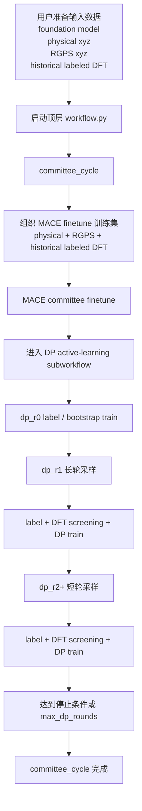

# DICE 用户使用手册

`DICE (Distillation-driven Co-Evolution)` 是一个面向机器学习势函数的闭环主动学习工作流。它通过 `MACE / MACE-LES teacher committee` 将知识蒸馏给 `DeepMD student committee`，同时由 `DeepMD student committee` 通过采样探索新的结构分布，并将高价值结构反馈给教师模型继续学习。

## 0. 标准启动方式

当前正式工作流的标准启动命令是：

```bash
./server_start_workflow.sh xx.yaml logname
```

例如：

```bash
./server_start_workflow.sh Pt-water-interface_roundN.yaml pt-water-interface_r1_1
```

其中：

- `xx.yaml`
  - 顶层 workflow YAML
- `logname`
  - 本次运行对应的日志名
  - 可以不带 `.log` 后缀

这条命令通过：

- [server_start_workflow.sh](C:\Users\1\Desktop\mlff_workflow\server_start_workflow.sh)

启动当前正式主线。

这份手册描述当前正式主线的工作流程、用户输入、运行时产物、配置文件语义和日志查看方式。

当前正式主线是：

- 顶层 `workflow.py`
  - `committee_cycle`
    - MACE committee finetune
    - DP active-learning subworkflow

当前顶层启动文件是：

- [Pt-water-interface_roundN.yaml]

## 1. 工作流程示意



当前顶层只负责编排 `committee_cycle`。  
当前大量 DFT 计算通常在工作流外手动执行，再把结果回灌到：

- `user_assets/dft/rX/labeled.xyz`

## 2. 用户需要准备什么

当前正式主线下，用户真正手动维护的是 `user_assets/...`。

### 2.1 foundation model

MACE finetune 会优先查找：

- `user_assets/foundation_models/*.model`

当前常见文件是：

- `user_assets/foundation_models/PtOH_LES_FOUNDATION_stagetwo.model`

### 2.2 MACE finetune 物理数据

如果 `committee_cycle.json` 中：

- `mace_finetune.training_data.base_datasets.include_physical = true`

则需要准备：

- `user_assets/mace_finetune/*.xyz`

当前常见文件是：

- `user_assets/mace_finetune/physical_all.xyz`

### 2.3 RGPS 数据

如果 `committee_cycle.json` 中：

- `mace_finetune.training_data.base_datasets.include_rgps = true`

则需要准备：

- `user_assets/mace_train/*.xyz`

当前常见文件是：

- `user_assets/mace_train/rgps_all.xyz`

### 2.4 历史 labeled DFT

当 `outer_round > 0` 时，当前正式主线会自动向前查找历史 labeled DFT 数据。

canonical 路径是：

- `user_assets/dft/r0/labeled.xyz`
- `user_assets/dft/r1/labeled.xyz`
- `user_assets/dft/r2/labeled.xyz`

每个 outer round 只使用一个合并后的 `labeled.xyz` 作为该轮历史 labeled DFT 输入。

### 2.5 外部 DFT 回灌格式

如果 DFT 是在工作流外手动完成，再回灌到当前仓库，canonical 路径仍然是：

- `user_assets/dft/rX/labeled.xyz`

可选失败文件是：

- `user_assets/dft/rX/failed.xyz`

回灌后会生成：

- `user_assets/dft/rX/summary.json`
- `user_assets/dft/rX/import_manifest.json`

当前正式主线中，外部 DFT 与工作流的衔接顺序是：

1. 先让当前一个 `outer_round` 正常运行完毕；
2. 从以下路径取出本轮累计的 screened DFT 候选结构：
   - `runs/<run_name>/data/dp_subworkflow/r<outer_round>/screened_dft_pool.xyz`
3. 在工作流外完成 DFT 计算与整理；
4. 把本轮整理好的 `labeled.xyz` 放回：
   - `user_assets/dft/r<当前 outer_round>/labeled.xyz`
5. 再启动下一轮 `outer_round`。

因此，如果本轮是 `outer_round = 1`，则：

- 先从以下路径取 `r1` 的 screened DFT 结果去做外部 DFT：
  - `runs/<run_name>/data/dp_subworkflow/r1/screened_dft_pool.xyz`
- 外部 DFT 完成后，把结果放回：
  - `user_assets/dft/r1/labeled.xyz`
- 然后下一轮 `outer_round = 2` 启动时，就会自动把这批历史 labeled DFT 纳入输入。

## 3. 运行过程中会生成什么

运行时数据和结果统一写入：

- `runs/<run_name>/`

其中：

- `runs/<run_name>/data/...`
  - 过程数据
- `runs/<run_name>/results/...`
  - 结果和状态
- `runs/<run_name>/logs/...`
  - step 日志
- `runs/<run_name>/run_meta/...`
  - 顶层 workflow 状态

### 3.1 committee_cycle 相关产物

当前 outer round 的 MACE finetune 合并训练集：

- `runs/<run_name>/data/committee_cycle/r<outer_round>/finetune_input/train_merged.xyz`

当前 outer round 的 `committee_cycle` 状态：

- `runs/<run_name>/results/committee_cycle/r<outer_round>/status.json`
- `runs/<run_name>/results/committee_cycle/r<outer_round>/workflow_state.json`

### 3.2 MACE committee 输出

teacher 输出目录形态是：

- `runs/<run_name>/results/mace_committee_model/r<outer_round>/teacher_xx/`

每个 `teacher_xx` 目录下常见产物包括：

- `mace_teacher_xx.model`
- `mace_teacher_xx_compiled.model`
- `checkpoints/...`

### 3.3 DP subworkflow 输出

当前 outer round 的 DP 子流程根目录：

- `runs/<run_name>/data/dp_subworkflow/r<outer_round>/`
- `runs/<run_name>/results/dp_subworkflow/r<outer_round>/`

每个 `dp_round` 下常见目录：

- `data/dp_subworkflow/r<outer_round>/dp_r<dp_round>/label/`
- `data/dp_subworkflow/r<outer_round>/dp_r<dp_round>/active_learning/`
- `results/dp_subworkflow/r<outer_round>/dp_r<dp_round>/dp_committee/`

当前 outer round 的 DP 子流程总状态：

- `runs/<run_name>/results/dp_subworkflow/r<outer_round>/status.json`

### 3.4 seed pool 输出

当前正式工作流启用 seed pool 时，会维护：

- `runs/<run_name>/data/seed_pool/seed_pool.xyz`
- `runs/<run_name>/data/seed_pool/seed_pool_meta.json`
- `runs/<run_name>/data/seed_pool/systems/`

outer round 结束时还会写最终 snapshot：

- `runs/<run_name>/results/seed_pool/r<outer_round>_final_seed_pool.xyz`
- `runs/<run_name>/results/seed_pool/r<outer_round>_final_seed_pool_meta.json`

### 3.5 DFT screening 输出

如果开启 DFT screening，会在每个 `dp_round` 下生成：

- `runs/<run_name>/results/dp_subworkflow/r<outer_round>/dp_r<dp_round>/dft_screening/summary.json`
- `runs/<run_name>/data/dp_subworkflow/r<outer_round>/dp_r<dp_round>/active_learning/dft_screened.xyz`

当前 outer round 的累计 screened pool：

- `runs/<run_name>/data/dp_subworkflow/r<outer_round>/screened_dft_pool.xyz`

其中：

- `runs/<run_name>/data/dp_subworkflow/r<outer_round>/dp_r<dp_round>/active_learning/dft_screened.xyz`
  - 是单个 `dp_round` 当轮筛选出的 DFT 候选；
- `runs/<run_name>/data/dp_subworkflow/r<outer_round>/screened_dft_pool.xyz`
  - 是当前整个 `outer_round` 截止目前累计得到的 screened DFT pool。

如果用户希望等当前一轮运行完毕后统一取结果去做外部 DFT，实际取数路径就是：

- `runs/<run_name>/data/dp_subworkflow/r<outer_round>/screened_dft_pool.xyz`

外部 DFT 完成后，再把整理好的结果放回：

- `user_assets/dft/r<outer_round>/labeled.xyz`

这样下一轮 `outer_round` 启动时，就会自动把这一轮的 DFT 结果作为历史 labeled DFT 输入继续使用。

## 4. 配置文件结构与语义

当前配置是链式结构，不是单个 JSON 独立工作。

配置链是：

1. 顶层 YAML
2. `committee_cycle.json`
3. `committee_finetune.json`
4. `active_learning_subworkflow.json`
5. `student_committee.json`
6. `label.json`

### 4.1 顶层 YAML

文件：

- [Pt-water-interface_roundN.yaml]

它负责：

- 指定 `run_name`
- 指定当前 `outer_round`
- 指定 `resume` 行为
- 指定顶层 `pipeline`
- 指定 `committee_cycle` 配置入口

当前正式写法是：

```yaml
run_name: Pt-water-interface
round: 0

resume:
  enabled: true
  mode: auto
  verify_success_markers: true
  rerun_incomplete_step: true
  backup_partial_outputs: true

pipeline:
  - committee_cycle

committee_cycle:
  config: configs/pipeline/committee_cycle.json
```

字段语义：

- `run_name`
  - 决定运行目录名，即 `runs/<run_name>`
- `round`
  - 当前 `outer_round`
- `resume.enabled`
  - 是否启用断点恢复
- `resume.mode`
  - 当前代码保留该字段，当前正式主线使用 `auto`
- `resume.verify_success_markers`
  - 恢复时是否验证 success marker
- `resume.rerun_incomplete_step`
  - 不完整 step 是否允许续跑
- `resume.backup_partial_outputs`
  - 恢复时是否备份局部产物

### 4.2 committee_cycle 配置

文件：

- [configs/pipeline/committee_cycle.json]

当前默认内容：

```json
{
  "mace_finetune": {
    "config": "configs/mace/committee_finetune.json",
    "reuse_existing_committee": false,
    "training_data": {
      "base_datasets": {
        "include_physical": true,
        "include_rgps": true
      }
    }
  },
  "dp_subworkflow": {
    "config": "configs/dp/active_learning_subworkflow.json"
  }
}
```

字段语义：

- `mace_finetune.config`
  - MACE finetune 配置文件路径
- `mace_finetune.reuse_existing_committee`
  - 是否复用当前 outer round 已存在的 teacher committee
  - `true`
    - 如果 `mace_committee_model/r<outer_round>/teacher_xx/` 下所有 teacher 模型都已存在且完整，则直接复用，不再重新训练
  - `false`
    - 强制重新训练本轮 teacher committee
- `mace_finetune.training_data.base_datasets.include_physical`
  - 是否纳入 `user_assets/mace_finetune/*.xyz`
- `mace_finetune.training_data.base_datasets.include_rgps`
  - 是否纳入 `user_assets/mace_train/*.xyz`
- `dp_subworkflow.config`
  - DP active-learning 子流程配置入口

### 4.3 MACE finetune 配置

文件：

- [configs/mace/committee_finetune.json]

这份配置里，和工作流行为直接相关的字段主要有：

- `teacher_num`
  - 本轮训练多少个 teacher
- `mace_backend`
  - 当前允许值：
    - `standard`
    - `les`
  - 当前正式配置使用：
    - `les`
- `device`
  - 当前代码按字符串透传到 MACE 训练命令
  - 当前正式配置使用：
    - `cuda`

本手册不展开 batch、epoch、lr 等 MACE 外部训练超参数。

### 4.4 DP subworkflow 配置

文件：

- [configs/dp/active_learning_subworkflow.json]

这份配置是当前工作流行为的核心。

#### 4.4.1 round 数控制

- `max_dp_rounds`
  - 当前 outer round 内最多允许多少个 `dp_round`
- `stop_ratio_threshold`
  - 用于基于高不确定度比例提前停止
- `resume`
  - DP subworkflow 内部是否启用恢复

#### 4.4.2 数据策略

- `bootstrap_data.include_rgps_in_initial_dataset`
  - 控制 `outer_round = 0, dp_r0` 的 bootstrap 数据是否纳入 RGPS
- `incremental_data.use_incremental_data_only`
  - 控制后续 DP 训练是否只使用增量数据
- `training_policy.round0_stage`
  - 当前允许值：
    - `bootstrap`
    - `finetune`
- `training_policy.later_round_stage`
  - 当前允许值：
    - `bootstrap`
    - `finetune`

当前正式配置是：

- `round0_stage = bootstrap`
- `later_round_stage = finetune`

#### 4.4.3 seed pool 策略

- `seed_pool_policy.enabled`
  - 是否启用正式 seed pool 机制
- `seed_pool_policy.initialize_at_subworkflow_start`
  - 是否在 subworkflow 开始时初始化 seed pool
- `seed_pool_policy.max_pool_size_per_system`
  - 每个 system 最多保留多少 seed
- `seed_pool_policy.refresh_after_training`
  - 每轮训练后是否刷新 seed pool

当前正式语义下：

- `enabled = true`
  - 会初始化 formal seed pool
  - 会在 `dp_r1+` 进行选种
  - 短轮后会更新 `times_used`
  - 训练后会刷新 seed pool
- `enabled = false`
  - 会跳过 formal seed pool 的初始化、选种、`times_used` 更新和刷新
  - 当前正式 `committee_cycle -> dp_subworkflow` 路径**没有另一套等价的替代选种策略**
  - 也就是说，关闭后并不会自动切换到别的正式采样种子来源；当前主线配置默认依赖 seed pool

#### 4.4.4 采样驱动总配置

- `sampling_seed_policy.backend`
  - 当前配置项允许写字符串，但当前正式实现只支持：
    - `lammps`
- `sampling_seed_policy.driver_policy`
  - 当前支持：
    - `round_robin`

#### 4.4.5 LAMMPS 运行策略

- `sampling_seed_policy.lammps.device_policy`
  - 当前支持：
    - `cpu`
    - `gpu_single_task`
    - `gpu_shared_experimental`
- `sampling_seed_policy.lammps.execution_backend`
  - 当前支持：
    - `inline`
    - `grouped_shell`
- `sampling_seed_policy.lammps.ensemble`
  - 当前支持：
    - `nve`
    - `nvt`
    - `langevin`
  - 当前正式配置使用：
    - `nvt`

其他 `lammps` 下的线程、group、频率类字段负责运行布局和输出频率。

#### 4.4.6 长短轮调度

- `sampling_schedule.mode`
  - 当前正式支持的模式：
    - `long_first_then_short`
- `sampling_schedule.long_round_selector`
  - 当前正式支持：
    - `first_sampling_round_only`
- `sampling_schedule.long_profile_name`
  - 指向长轮 profile 名称
- `sampling_schedule.short_profile_name`
  - 指向短轮 profile 名称

当前正式语义：

- `dp_r1`
  - 使用 `long_profile_name`
- `dp_r2+`
  - 使用 `short_profile_name`

#### 4.4.7 长轮 profile

当前正式 profile 名是：

- `long_exploration`

其关键字段：

- `seed_selection.n_seed_per_system`
  - 每个 system 选多少个 seed
- `seed_selection.selection_mode`
  - 当前支持：
    - `top_uncertainty_per_system`
- `sampling.temperature_schedule`
  - 长轮温度列表
- `sampling.steps`
  - 长轮步数
- `candidate_train_selection.enabled`
  - 是否从 candidate 中抽取训练集
- `candidate_train_selection.selection_mode`
  - 当前支持：
    - `random_per_system`
- `seed_pool.refresh_mode`
  - 当前支持：
    - `merge_old_pool_with_current_candidate_failed`

`merge_old_pool_with_current_candidate_failed` 的语义是：

- 用当前 candidate 和 failed 与旧 pool 合并
- 再重建新的 seed pool

#### 4.4.8 短轮 profile

当前正式 profile 名是：

- `short_refinement`

其关键字段：

- `seed_selection.n_seed_per_system`
  - 每个 system 选多少个 seed
- `seed_selection.selection_mode`
  - 当前支持：
    - `usage_then_uncertainty_per_system`
- `sampling.temperature_schedule`
  - 短轮温度列表
- `sampling.steps`
  - 短轮步数
- `candidate_train_selection.selection_mode`
  - 当前支持：
    - `random_per_system`
- `seed_pool.refresh_mode`
  - 当前支持：
    - `rescore_existing_pool_only`

`rescore_existing_pool_only` 的语义是：

- 不把当前 candidate/failed 并回 pool
- 只对已有 seed pool 用新 committee 重新打分

#### 4.4.9 DFT screening

- `dft_screening_policy.enabled`
  - 是否启用 DFT screening
- `dft_screening_policy.selection_mode`
  - 当前正式支持：
    - `bucket_random_per_system`
- `budget_per_system`
  - 每个 system 最多保留多少 screened DFT 候选
- `signature_neighbor_order`
- `signature_quantiles`
- `bucket_width`
- `keep_top_per_bucket`
  - 共同控制 screening 的结构 bucket 去重
- `stop_dp_round_when_current_screened_count_gte`
  - 当前轮 screened 数达到阈值时停止
- `stop_dp_round_when_cumulative_screened_count_gte`
  - 当前 outer round 累计 screened 数达到阈值时停止

### 4.5 DP committee 训练配置

文件：

- [configs/dp/student_committee.json]

和工作流行为直接相关的字段：

- `bootstrap_train_config`
  - `dp_r0 bootstrap` 使用的训练模板
- `finetune_train_config`
  - 后续 finetune 使用的训练模板
- `committee_size`
  - 本轮训练多少个 DP member
- `model_seeds`
  - 每个 member 的随机种子
- `dp_command`
  - DP 训练命令
- `freeze_command`
  - 冻结出 `graph.pb` 的命令
- `env`
  - 每次 DP committee 训练时附加的环境变量
- `reuse_existing_split`
  - 是否复用已有 train/valid split
- `reuse_existing_model`
  - 是否复用已有 member 模型
- `max_retries_per_member`
  - 单个 member 失败后的最大重试次数
- `retry_seed_stride`
  - 重试时种子偏移步长

### 4.6 label 配置

文件：

- [configs/label/label.json]

和工作流行为直接相关的字段：

- `teacher_num`
  - label 时使用多少个 teacher
- `candidate_sigma_threshold`
  - candidate 判定阈值
- `max_force`
  - 过滤过大力的阈值
- `device`
  - 当前正式配置使用：
    - `cuda`

## 5. 如何查看日志和状态文件

当前日志分两层：

- 顶层启动日志
- runtime 内部 step 日志

### 5.1 顶层启动日志

默认写到：

- `logs/<自动生成名>.log`

如果手动指定第二个参数，则写到：

- `logs/<指定名>.log`

这层日志主要包含：

- conda 环境信息
- 顶层 workflow 启动信息
- 当前 runtime root
- 当前运行到的顶层 step
- 顶层 traceback

### 5.2 runtime 内部 step 日志

step 日志统一在：

- `runs/<run_name>/logs/r<outer_round>/`

常见文件形态：

- `runs/<run_name>/logs/r<outer_round>/train_mace.log`
- `runs/<run_name>/logs/r<outer_round>/teacher_xx.log`

### 5.3 顶层 workflow 状态文件

顶层 outer round 状态：

- `runs/<run_name>/run_meta/rounds/r<outer_round>/workflow_state.json`

这个文件记录：

- 顶层 step 列表
- 每个 step 的 `PENDING / RUNNING / SUCCESS / FAILED`
- marker 路径
- 当前恢复位置

### 5.4 committee_cycle 内部状态文件

- `runs/<run_name>/results/committee_cycle/r<outer_round>/workflow_state.json`
- `runs/<run_name>/results/committee_cycle/r<outer_round>/status.json`

这两个文件分别记录：

- `finetune` 和 `dp_subworkflow` 两个内部 step 的状态
- 当前 outer round 的 committee_cycle 总结论

### 5.5 DP subworkflow 状态文件

- `runs/<run_name>/results/dp_subworkflow/r<outer_round>/status.json`

它记录：

- 当前 `current_dp_round`
- `finished_rounds`
- 是否 `stopped`
- `stop_reason`
- `final_dp_model_path`
- 若干累计统计量
