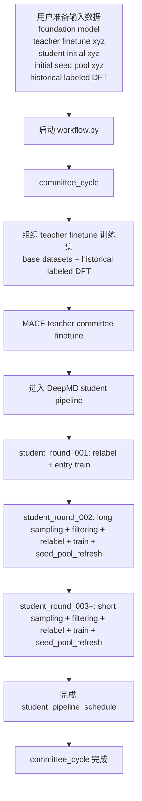

# DICE 用户使用手册

`DICE (Distillation-driven Co-Evolution)` 是一个面向机器学习势函数的闭环主动学习工作流。当前 `v0.1.0` release 默认主线使用 MACE / MACE-LES teacher committee 做高质量标注与筛分，使用 DeepMD student committee 做低成本采样和不确定度评估。DeepMD DPA-4 已作为上游 teacher backend 接入，可通过 `teacher_backend = "deepmd"` 和 DPA-4 teacher 配置切换。

本文覆盖 release 分支的正式运行方式、用户输入、运行时产物、配置文件结构和状态查看方式。

## 0. 标准启动方式

当前正式工作流的标准启动命令是：

```bash
python workflow.py xx.yaml
```

例如：

```bash
python workflow.py Pt-water-interface_roundN.yaml
```

其中：

- `xx.yaml`
  - 顶层 workflow YAML

在服务器上需要断开终端后继续运行时，可以使用本机的进程管理方式，例如：

```bash
nohup python workflow.py Pt-water-interface_roundN.yaml > logs/pt-water-interface_r1_1.log 2>&1 &
```

运行前应先进入具备 MACE、DeepMD、LAMMPS 等能力的环境，并设置好 CUDA、线程、plugin 路径等本机环境变量。

默认示例主线是：

- 顶层 [`workflow.py`](./workflow.py)
  - `committee_cycle`
    - MACE / MACE-LES teacher committee finetune
    - DeepMD active-learning student subworkflow

teacher backend 是可切换的。除默认 MACE / MACE-LES teacher 外，仓库已包含 DeepMD DPA-4 teacher committee finetune 与 relabel 支持；切换时需要把 `committee_cycle` 中的 `teacher_committee_finetune.teacher_backend` 改为 `deepmd`，并指向 DPA-4 teacher 配置。

当前示例顶层启动文件是：

- [`Pt-water-interface_roundN.yaml`](./Pt-water-interface_roundN.yaml)

## 1. 工作流程示意



当前顶层只编排 `committee_cycle`。外部 DFT 通常在工作流外手动完成，再把结果回灌到：

- `user_assets/dft/rX/labeled.xyz`

当 `outer_round > 0` 时，teacher finetune 会自动读取之前轮次的 labeled DFT 结果。

## 2. 用户需要准备什么

当前正式主线下，用户主要维护 `user_assets/...`。配置里使用的相对输入文件名通常是“裸文件名”，代码会按固定目录解析。

### 2.1 MACE foundation model

MACE finetune 会优先查找：

- `user_assets/foundation_models/*stagetwo*.model`
- `user_assets/foundation_models/*.model`

也可以在 teacher finetune 配置里用 `workflow.foundation_model` 指定某个 foundation model 文件名。

### 2.2 Teacher finetune 基础数据

默认 MACE / MACE-LES teacher finetune 配置为：

- [`configs/pipelines/committee_cycle/teacher_committee_finetune/mace/committee_finetune.json`](./configs/pipelines/committee_cycle/teacher_committee_finetune/mace/committee_finetune.json)

其中：

```json
"training_data": {
  "base_datasets": [
    "base.xyz"
  ]
}
```

因此用户需要准备：

- `user_assets/teacher_finetune/base.xyz`

`training_data.base_datasets` 不接受 glob；如果要使用多个 teacher finetune 数据文件，应在配置里逐个列出裸文件名或绝对路径。

### 2.2.1 DeepMD DPA-4 teacher 选项

DPA-4 已接入 teacher backend，可作为 `committee_cycle` 的上游 teacher 使用。对应配置文件是：

- [`configs/pipelines/committee_cycle/teacher_committee_finetune/deepmd/dpa4/committee_finetune.json`](./configs/pipelines/committee_cycle/teacher_committee_finetune/deepmd/dpa4/committee_finetune.json)
- [`configs/pipelines/teacher_foundation_train/deepmd/dpa4/foundation_train.json`](./configs/pipelines/teacher_foundation_train/deepmd/dpa4/foundation_train.json)

切换 committee-cycle teacher 时，把 pipeline 配置中的 teacher 段改为：

```json
"teacher_committee_finetune": {
  "teacher_backend": "deepmd",
  "config": "configs/pipelines/committee_cycle/teacher_committee_finetune/deepmd/dpa4/committee_finetune.json",
  "reuse_existing_committee": true
}
```

DPA-4 teacher 仍复用 `user_assets/teacher_finetune/` 中的 base datasets 和历史 `user_assets/dft/rX/labeled.xyz` 数据；环境上需要 DeepMD `dp` 命令、DPA-4 模型支持，以及 relabel 时可用的 DeepMD/LAMMPS 能力。

### 2.3 Student 初始训练数据

当前 DeepMD student subworkflow 配置为：

- [`configs/pipelines/committee_cycle/student_subworkflow/deepmd/active_learning/subworkflow.json`](./configs/pipelines/committee_cycle/student_subworkflow/deepmd/active_learning/subworkflow.json)

其中：

```json
"initial_student_inputs": [
  "bootstrap.xyz"
]
```

因此用户需要准备：

- `user_assets/student_initial/bootstrap.xyz`

这份数据用于 entry relabel / entry train 阶段。

### 2.4 初始 seed pool

同一份 `subworkflow.json` 中：

```json
"source": {
  "initial_seed_pool": [
    "initial_physical_seed.xyz"
  ]
}
```

因此用户需要准备：

- `user_assets/seed_pool/initial_physical_seed.xyz`

该文件会在首次需要 sampling 或 seed pool refresh 时被快照到运行目录中。

### 2.5 历史 labeled DFT

当 `outer_round > 0` 时，当前正式主线会自动向前查找历史 labeled DFT 数据。

canonical 路径是：

- `user_assets/dft/r0/labeled.xyz`
- `user_assets/dft/r1/labeled.xyz`
- `user_assets/dft/r2/labeled.xyz`

也就是说，启动 `round: 2` 时，代码会尝试读取 `r0` 和 `r1` 的 labeled DFT 结果。每轮可以放一个标准合并后的 `labeled.xyz`。

### 2.6 外部 DFT 回灌格式

如果 DFT 是在工作流外手动完成，再回灌到当前仓库，推荐路径是：

- `user_assets/dft/rX/labeled.xyz`

可选失败文件是：

- `user_assets/dft/rX/failed.xyz`

如果通过代码里的 external import 逻辑导入，还会生成：

- `user_assets/dft/rX/import_summary.json`
- `user_assets/dft/rX/import_manifest.json`
- `user_assets/dft/rX/source_snapshot/`

当前 shipped DeepMD schedule 没有启用独立的 `teacher_dft_candidate_filtering` stage。每个 relabel stage 会产生 teacher DFT candidate：

- `runs/<run_name>/artifacts/teacher_round_XXX/committee_cycle/student_subworkflow/student_round_YYY/stage_ZZ_relabel/active_learning/dft.xyz`

用户可以从这些 `dft.xyz` 中整理外部 DFT 输入。外部 DFT 完成后，把本轮整理好的 `labeled.xyz` 放回：

- `user_assets/dft/r<当前 outer_round>/labeled.xyz`

然后下一轮 `outer_round` 启动时，这批 labeled DFT 会自动纳入 teacher finetune 数据。

## 3. 运行过程中会生成什么

运行时数据统一写入：

- `runs/<run_name>/`

当前 release 的运行目录分三层：

- `runs/<run_name>/artifacts/...`
  - 工作流产物、阶段输入输出、训练目录、summary 文件
- `runs/<run_name>/runtime/...`
  - marker、snapshot、preflight、恢复状态相关文件
- `runs/<run_name>/logs/...`
  - 顶层和各 backend 的 stdout / stderr / backend logs

### 3.1 顶层 runtime 文件

当前 `outer_round` 的 launch snapshot：

- `runs/<run_name>/runtime/teacher_round_XXX/snapshot/workflow_launch_snapshot.json`

当前 `outer_round` 的 marker 目录：

- `runs/<run_name>/runtime/teacher_round_XXX/markers/`

其中 `XXX` 是三位补零的 teacher round，例如 `teacher_round_000`。

### 3.2 committee_cycle / teacher 输出

当前 outer round 的 committee cycle artifact 根目录：

- `runs/<run_name>/artifacts/teacher_round_XXX/committee_cycle/`

MACE teacher committee finetune 输出目录：

- `runs/<run_name>/artifacts/teacher_round_XXX/committee_cycle/teacher_committee_finetune/`

常见产物包括：

- `input/merged.xyz`
- `teacher_committee_finetune_runtime.json`
- `teacher_01/`
- `teacher_02/`
- `teacher_03/`

每个 `teacher_xx` 目录下通常会包含训练产物和最终 MACE model。

### 3.3 DeepMD student pipeline 输出

当前 outer round 的 student subworkflow 根目录：

- `runs/<run_name>/artifacts/teacher_round_XXX/committee_cycle/student_subworkflow/`

初始 seed pool 快照：

- `runs/<run_name>/artifacts/teacher_round_XXX/committee_cycle/student_subworkflow/source/initial_seed_pool.xyz`

每个 student round 的目录形态是：

- `runs/<run_name>/artifacts/teacher_round_XXX/committee_cycle/student_subworkflow/student_round_YYY/`

每个 stage 的目录形态是：

- `stage_01_relabel/`
- `stage_02_train/`
- `stage_01_sampling/`
- `stage_02_student_relabel_input_filtering/`
- `stage_03_relabel/`
- `stage_04_train/`
- `stage_05_seed_pool_refresh/`

常见 stage 产物包括：

- relabel stage
  - `label/train.xyz`
  - `label/discard.xyz`
  - `active_learning/dft.xyz`
  - `train_merged.xyz`
- train stage
  - `input/train.xyz`
  - `student_committee/`
  - `student_committee_summary.json`
- sampling stage
  - `input/seed_pool.xyz`
  - `seed_pool.xyz`
  - `candidate.xyz`
  - `failed.xyz`
  - `seed_pool_after_sampling.xyz`
- student relabel input filtering stage
  - `input/candidate.xyz`
  - `input/failed.xyz`
  - `filtered_candidate.xyz`
  - `filtered_failed.xyz`
- seed pool refresh stage
  - `input/seed_pool.xyz`
  - `input/candidate_increment.xyz`
  - `input/failed_increment.xyz`
  - `seed_pool.xyz`

### 3.4 日志输出

如果使用 `nohup` 或其他进程管理器启动，顶层 stdout / stderr 日志由启动命令中的重定向路径决定，例如：

- `logs/pt-water-interface_r1_1.log`

工作流内部 logs 写到：

- `runs/<run_name>/logs/teacher_round_XXX/...`

例如 student stage 的 stdout / stderr：

- `runs/<run_name>/logs/teacher_round_XXX/committee_cycle/student_subworkflow/student_round_YYY/stage_ZZ_<stage>/stdout.log`
- `runs/<run_name>/logs/teacher_round_XXX/committee_cycle/student_subworkflow/student_round_YYY/stage_ZZ_<stage>/stderr.log`

backend 日志通常写到同级或下级的 `backend_logs/` 目录。

## 4. 配置文件结构与语义

release 使用 pipeline-template 模式。配置链是：

1. 顶层 YAML
2. `configs/pipelines/committee_cycle/pipeline.json`
3. teacher finetune 配置
4. student subworkflow 配置
5. student pipeline templates
6. stage configs

### 4.1 顶层 YAML

文件：

- [`Pt-water-interface_roundN.yaml`](./Pt-water-interface_roundN.yaml)

当前内容是：

```yaml
run_name: Pt-water-interface
round: 0

resume:
  enabled: true

pipeline:
  - committee_cycle

committee_cycle:
  config: configs/pipelines/committee_cycle/pipeline.json
```

字段语义：

- `run_name`
  - 决定运行目录名，即 `runs/<run_name>`
- `round`
  - 当前 outer round / teacher round
- `resume.enabled`
  - 是否启用 marker-based 断点恢复
- `pipeline`
  - 当前正式主线只启用 `committee_cycle`
- `committee_cycle.config`
  - committee cycle 配置入口

### 4.2 committee_cycle 配置

文件：

- [`configs/pipelines/committee_cycle/pipeline.json`](./configs/pipelines/committee_cycle/pipeline.json)

当前内容是：

```json
{
  "teacher_committee_finetune": {
    "teacher_backend": "mace",
    "config": "configs/pipelines/committee_cycle/teacher_committee_finetune/mace/committee_finetune.json",
    "reuse_existing_committee": true
  },
  "student_subworkflow": {
    "config": "configs/pipelines/committee_cycle/student_subworkflow/deepmd/active_learning/subworkflow.json"
  }
}
```

字段语义：

- `teacher_committee_finetune.teacher_backend`
  - 默认示例为 `mace`；也支持 `deepmd`，用于 DeepMD DPA-4 teacher
- `teacher_committee_finetune.config`
  - teacher finetune 配置文件路径，需与 `teacher_backend` 匹配
- `teacher_committee_finetune.reuse_existing_committee`
  - 如果当前 round 的 teacher committee 已完整存在，则复用已有模型
- `student_subworkflow.config`
  - DeepMD student pipeline 配置入口

### 4.3 MACE teacher finetune 配置

文件：

- [`configs/pipelines/committee_cycle/teacher_committee_finetune/mace/committee_finetune.json`](./configs/pipelines/committee_cycle/teacher_committee_finetune/mace/committee_finetune.json)

关键字段：

- `workflow.model_family`
  - 当前为 `les`
- `workflow.teacher_num`
  - 当前 teacher committee 成员数，默认是 `3`
- `workflow.teacher_seeds`
  - 每个 teacher 成员使用的随机种子
- `workflow.training_data.base_datasets`
  - teacher finetune 基础数据文件名列表，默认从 `user_assets/teacher_finetune/` 解析
- `workflow.foundation_model`
  - 可选；未指定时自动从 `user_assets/foundation_models/` 查找 model
- `mace.*`
  - MACE 原生训练参数，例如 `batch_size`、`max_num_epochs`、`lr`、`device` 等

### 4.3.1 DeepMD DPA-4 teacher 配置

文件：

- [`configs/pipelines/committee_cycle/teacher_committee_finetune/deepmd/dpa4/committee_finetune.json`](./configs/pipelines/committee_cycle/teacher_committee_finetune/deepmd/dpa4/committee_finetune.json)

关键字段：

- `workflow.model_family`
  - 当前为 `dpa4`
- `workflow.init_mode`
  - 当前示例为 `scratch`
- `workflow.teacher_num`
  - DPA-4 teacher committee 成员数
- `workflow.teacher_seeds`
  - 每个 teacher 成员使用的随机种子
- `workflow.type_map`
  - 元素顺序，当前为 `H, O, Pt`
- `workflow.training_data.base_datasets`
  - teacher 训练基础数据，默认从 `user_assets/teacher_finetune/` 解析
- `deepmd.model`
  - DeepMD DPA-4 模型结构配置
- `deepmd.training`
  - DeepMD 原生训练配置

当上游 teacher backend 为 `deepmd` 时，student relabel stage 会继承该 teacher backend；relabel 配置中如果显式写 `teacher_backend`，必须与上游 `teacher_committee_finetune.teacher_backend` 一致。

### 4.4 DeepMD student subworkflow 配置

文件：

- [`configs/pipelines/committee_cycle/student_subworkflow/deepmd/active_learning/subworkflow.json`](./configs/pipelines/committee_cycle/student_subworkflow/deepmd/active_learning/subworkflow.json)

关键字段：

- `student_backend`
  - 当前为 `deepmd`
- `sampling_backend`
  - 当前为 `lammps`
- `train_regime.use_foundation_model`
  - 当前为 `false`
- `train_regime.continue_training`
  - 当前为 `true`，后续 train stage 会基于前一轮 student committee 继续训练
- `initial_student_inputs`
  - 初始 student relabel 输入，默认从 `user_assets/student_initial/` 解析
- `source.initial_seed_pool`
  - 初始 seed pool，默认从 `user_assets/seed_pool/` 解析
- `student_model.type_map`
  - 当前为 `H, O, Pt`
- `student_model.committee_size`
  - 当前 DeepMD student committee 成员数，默认是 `4`
- `deepmd.training.model_seeds`
  - 每个 student member 的随机种子
- `sampling_backend_config.lammps.device_policy`
  - 当前为 `gpu_shared_experimental`
- `sampling_backend_config.lammps.execution_backend`
  - 当前为 `grouped_shell`
- `uncertainty.metric`
  - 当前为 `force_std_max`
- `uncertainty.trust_lo` / `uncertainty.trust_hi`
  - student sampling 不确定度分流阈值
- `student_pipeline_templates`
  - template 名到 template JSON 的映射
- `student_pipeline_schedule`
  - 具体执行顺序

当前 schedule 是：

```json
[
  {"template": "entry", "repeat": 1},
  {"template": "long_cycle", "repeat": 1},
  {"template": "short_cycle", "repeat": 3}
]
```

因此默认会执行 5 个 student round。

### 4.5 student pipeline templates

模板目录：

- [`configs/pipelines/committee_cycle/student_subworkflow/deepmd/active_learning/templates/`](./configs/pipelines/committee_cycle/student_subworkflow/deepmd/active_learning/templates/)

当前模板：

- `entry.json`
  - `relabel`
  - `train`
- `long_cycle.json`
  - `sampling`
  - `student_relabel_input_filtering`
  - `relabel`
  - `train`
  - `seed_pool_refresh`
- `short_cycle.json`
  - `sampling`
  - `student_relabel_input_filtering`
  - `relabel`
  - `train`
  - `seed_pool_refresh`

### 4.6 stage configs

stage 配置目录：

- [`configs/pipelines/committee_cycle/student_subworkflow/deepmd/active_learning/stages/`](./configs/pipelines/committee_cycle/student_subworkflow/deepmd/active_learning/stages/)

#### relabel

文件：

- [`stages/relabel/teacher_relabel.json`](./configs/pipelines/committee_cycle/student_subworkflow/deepmd/active_learning/stages/relabel/teacher_relabel.json)

关键字段：

- `teacher_backend_options.model_family`
  - 当前为 `les`
- `teacher_backend_options.device`
  - 当前为 `cuda`
- `teacher_trust_lo`
  - teacher relabel 时的 candidate 阈值
- `max_force`
  - 过滤过大力结构
- `valid_fraction`
  - 输出训练集时的验证集比例
- `element_order`
  - 元素顺序，当前为 `H, O, Pt`

#### train

文件：

- [`stages/train/entry_train.json`](./configs/pipelines/committee_cycle/student_subworkflow/deepmd/active_learning/stages/train/entry_train.json)
- [`stages/train/continuation_train.json`](./configs/pipelines/committee_cycle/student_subworkflow/deepmd/active_learning/stages/train/continuation_train.json)

这两份文件主要包含 DeepMD 原生 `dp_config`。entry train 使用较长训练步数；continuation train 使用较小学习率和较短训练步数。

#### sampling

文件：

- [`stages/sampling/long_md.json`](./configs/pipelines/committee_cycle/student_subworkflow/deepmd/active_learning/stages/sampling/long_md.json)
- [`stages/sampling/short_md.json`](./configs/pipelines/committee_cycle/student_subworkflow/deepmd/active_learning/stages/sampling/short_md.json)
- [`stages/sampling/input.lammps`](./configs/pipelines/committee_cycle/student_subworkflow/deepmd/active_learning/stages/sampling/input.lammps)

关键差异：

- long sampling
  - `selection_mode = top_uncertainty_per_system`
  - `n_seed_per_system = 1`
  - `temperature_schedule = [273, 323, 373]`
  - `steps = 20000`
- short sampling
  - `selection_mode = usage_then_uncertainty_per_system`
  - `n_seed_per_system = 15`
  - `temperature_schedule = [273, 373]`
  - `steps = 1000`

#### student_relabel_input_filtering

文件：

- [`stages/student_relabel_input_filtering/long_random_cap.json`](./configs/pipelines/committee_cycle/student_subworkflow/deepmd/active_learning/stages/student_relabel_input_filtering/long_random_cap.json)
- [`stages/student_relabel_input_filtering/short_random_cap.json`](./configs/pipelines/committee_cycle/student_subworkflow/deepmd/active_learning/stages/student_relabel_input_filtering/short_random_cap.json)

当前 selection mode 是 `random_per_system`，用于限制进入 teacher relabel 的 candidate / failed 数量。

#### seed_pool_refresh

文件：

- [`stages/seed_pool_refresh/long_refresh.json`](./configs/pipelines/committee_cycle/student_subworkflow/deepmd/active_learning/stages/seed_pool_refresh/long_refresh.json)
- [`stages/seed_pool_refresh/short_refresh.json`](./configs/pipelines/committee_cycle/student_subworkflow/deepmd/active_learning/stages/seed_pool_refresh/short_refresh.json)

当前 long refresh 使用 `top_uncertainty_per_system`，short refresh 使用 `usage_then_uncertainty_per_system`。两者都会限制每个 system 的最大 seed pool 数量，并按新的 student committee 重新评分。

## 5. 如何查看日志和状态文件

### 5.1 顶层启动日志

默认写到：

- `logs/<自动生成名>.log`

如果手动指定第二个参数，则写到：

- `logs/<指定名>.log`

这层日志主要包含：

- conda 环境信息
- 顶层 workflow 启动信息
- workspace root
- runtime root
- 当前运行到的 step
- 顶层 traceback

### 5.2 workflow marker 状态

marker 目录：

- `runs/<run_name>/runtime/teacher_round_XXX/markers/`

常见 marker 后缀：

- `.running`
- `.success`
- `.failed`
- `.interrupted`

恢复逻辑会根据这些 marker 和各 step 的 success check 判断从哪里继续。

### 5.3 student stage 日志

student stage 的 stdout / stderr 路径形态是：

- `runs/<run_name>/logs/teacher_round_XXX/committee_cycle/student_subworkflow/student_round_YYY/stage_ZZ_<stage>/stdout.log`
- `runs/<run_name>/logs/teacher_round_XXX/committee_cycle/student_subworkflow/student_round_YYY/stage_ZZ_<stage>/stderr.log`

teacher finetune backend 日志路径形态是：

- `runs/<run_name>/logs/teacher_round_XXX/committee_cycle/teacher_committee_finetune/backend_logs/`

### 5.4 快速定位最终模型

MACE teacher committee：

- `runs/<run_name>/artifacts/teacher_round_XXX/committee_cycle/teacher_committee_finetune/teacher_01/`
- `runs/<run_name>/artifacts/teacher_round_XXX/committee_cycle/teacher_committee_finetune/teacher_02/`
- `runs/<run_name>/artifacts/teacher_round_XXX/committee_cycle/teacher_committee_finetune/teacher_03/`

DeepMD student committee：

- `runs/<run_name>/artifacts/teacher_round_XXX/committee_cycle/student_subworkflow/student_round_YYY/stage_ZZ_train/student_committee/`
- `runs/<run_name>/artifacts/teacher_round_XXX/committee_cycle/student_subworkflow/student_round_YYY/stage_ZZ_train/student_committee_summary.json`

通常最后一个成功的 train stage 就是当前 schedule 的最终 student committee。

## 6. 常见操作建议

- 修改 `round` 后再启动下一轮 outer round。
- 每轮外部 DFT 结果放入 `user_assets/dft/rX/labeled.xyz`，其中 `X` 应等于该批候选来自的 outer round。
- 不要把大型模型、轨迹、`runs/` 输出和临时 DFT 任务目录提交到 git。
- 如果需要复跑某个失败阶段，优先保留 marker 和日志，确认失败原因后再清理对应 stage 产物。
- 修改配置路径时，优先使用当前 `configs/pipelines/committee_cycle/...` 结构，不要再使用旧版 `configs/dp/...`、`configs/mace/...`、`configs/label/...` 路径。
