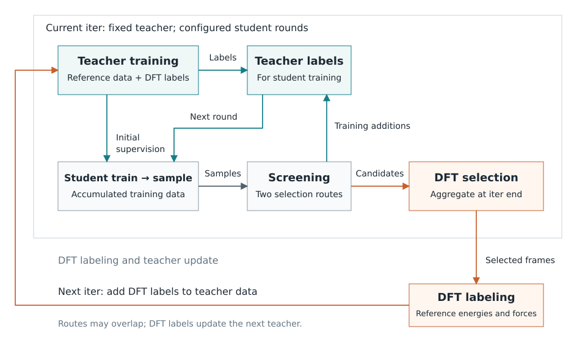

# Workflow

DICE organizes potential development through teacher updates and student training cycles. An **iter** contains a teacher update followed by student exploration. A **round** is one student training, sampling and screening cycle.

## Iterations and rounds

| Level | Work | Model update |
| --- | --- | --- |
| One iter | Teacher training, initial student supervision, one or more rounds, final DFT selection | Teacher updates once at the start, then remains fixed |
| One round | Student training → sampling → screening | Student trains on accumulated data and explores configurations |
| Next iter | Teacher update with new DFT labels, then new student rounds | Updated teacher relabels carried student geometries |

Both are numbered from zero. A two-round example is:

```text
iter0: teacher training and initial student supervision
  → r0: student training → sampling → screening
  → r1: student training → sampling → screening
  → aggregate candidates and select configurations for DFT

DFT labels update reference data for the next iter
  → iter1: teacher update → student rounds → DFT selection
```

## Three data streams



| Data | Source | Purpose |
| --- | --- | --- |
| Teacher reference data | Existing and newly calculated DFT labels | Teacher training and validation |
| Student training data | Teacher predictions for student geometries | Student training, expanded by screening |
| DFT candidates | Sampled configurations meeting DFT-candidate conditions | Representative selection and new reference calculations |

Teacher predictions expand student data. DFT labels update the teacher, whose supervision then affects later student training.

## Student-data growth within an iter

The first iter trains the teacher from reference data and labels the initial student geometries to form the first-round training set.

After each student train, the current student samples from the assigned seeds. DICE evaluates observations and selects training additions and DFT candidates. Teacher-labelled additions merge with existing student data, are deduplicated and feed the next round. Terminal-round additions carry into the next iter.

A configuration can satisfy both teacher-trust and DFT-candidate conditions and participate in both selections. See [Configuration screening](screening.md). Each round starts sampling from its configured seeds.

## What carries into the next iter

| Model | Next-iter behavior |
| --- | --- |
| Teacher | Updates from retained reference data and new DFT labels |
| Student | Carries terminal-round training geometries and additions forward; the new teacher relabels them for the first round |

The updated teacher supervises the new iter while the student accumulates data and explores further configurations.

See [Quickstart](../getting-started/quickstart.md) for execution and label return, [Prepare input files](../guides/inputs.md) for data/training inputs, and [Inspect results and resume](../guides/results-and-recovery.md) for outputs and continuation.
