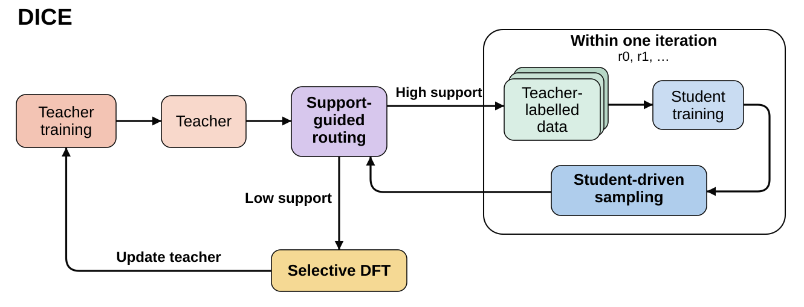

# Introduction to DICE

DICE combines active learning and knowledge distillation to develop interatomic potentials. A student explores new configurations, and DICE evaluates whether the teacher can label them reliably. Selected configurations with reliable teacher predictions receive teacher labels and expand the student training set. Configurations requiring reference calculations are selected for DFT; the new reference labels update the teacher in the next iteration.

## How DICE runs

Selective DFT in the figure denotes reference calculations on selected configurations. Their labels update the teacher in the next iteration.

An **iter** contains one teacher-training stage and one or more student **rounds**, named `r0`, `r1`, and so on.

1. **Prepare the teacher and initial supervision.** Train the teacher on existing DFT reference data and generate teacher labels for the student's initial training configurations.
2. **Train the student and explore.** Train the student on the current dataset, then sample from the configured initial structures and conditions.
3. **Assess teacher-label reliability and select configurations.** Selected configurations that the teacher can label reliably receive energy, force and other labels for student training. Other configurations enter the DFT candidate pool for subsequent selection and calculation.
4. **Complete the student rounds.** The teacher stays fixed within the iter while the student repeats training, sampling and screening. DICE then selects configurations for DFT.
5. **Calculate DFT labels and update the teacher.** Add the new reference labels to the teacher data. The next iter trains the teacher on the expanded dataset and prepares supervision for the next student cycle.

Teacher labels are model predictions; DFT labels come from reference calculations. See [Workflow](../concepts/workflow.md) for model updates and data flow, and [Configuration screening](../concepts/screening.md) for scores and selection.

## What to prepare

| Input | Purpose |
| --- | --- |
| Initial DFT data | Reference energy, force and other labels for teacher training |
| Initial configurations | Geometries for initial student training and starting structures for sampling |
| Backend environments | Model training, inference and configuration sampling |
| Run configuration and resources | Training settings, sampling conditions, screening and compute allocation |
| DFT environment and resources | Reference calculations on selected configurations |

## Next steps

Start with [Installation](installation.md), then follow the [Quickstart](quickstart.md) through the first iter, DFT-label return and the next iter.
